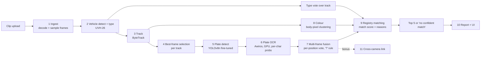

# TRACEVISION AI — Pipeline Design (Phase 1–3)

**Status:** P1–P4 done. The owner approved all remaining phases on 2026-11-23 (see §10). Updated 2026-11-23.
Problem: **AIML-01 Vehicle Identification and Traceability from CCTV Footage**. Related: [DECISIONS.md](DECISIONS.md) · [PROBLEMS.md](PROBLEMS.md) · [whatnext.md](whatnext.md) · [TEAM_TASKS.md](TEAM_TASKS.md)

---

## 1. What the system must do

The investigator uploads a clip. For every vehicle the system must:
1. **read the plate across several frames**, writing `?` for characters it can't read and never guessing them
2. **extract attributes:** vehicle type and colour (make/model is a bonus)
3. **rank the top 5 registry candidates**, each with a **match score** and **human-readable reasons**
4. **say "no confident match"** when nothing fits
5. produce an **investigator UI** and a **report per clip**: the frames used, characters per frame with confidence, the fused plate, the top 5 with reasons
6. *bonus:* link the same vehicle across two clips (cross-camera)

**Scores are kept separate everywhere** (DECISIONS E9): detector confidence, OCR character probability, and match score. Never call any of them a "probability" unless it has been calibrated.

---

## 2. Architecture



One clip runs as a **batch job**: there's no real-time requirement. Every stage writes its output to the job folder, so any stage can be re-run, inspected or shown in the report.

---

## 3. Stages

| # | Stage | Input → Output | Method | Built on | Status |
|---|---|---|---|---|---|
| 1 | **Ingest** | clip → frames (original frame index + timestamp) | OpenCV streaming decode. **Detection runs on every 2nd frame** (15 fps for 30 fps clips), so the tracker stays stable. Store the original frame indices. | `extract_test_video_frames.py` logic | Logic exists |
| 2 | **Vehicle detection + type** ✅ P1 | frame → boxes, class, detector confidence | **UVH-26 YOLOv11-S** (Indian vehicles). Classes are mapped to our vocabulary through `class_mapping.json`, built from the model's **real** class names (B3). Two-wheeler → `motorcycle/scooter` (ambiguous), Three-wheeler → `auto_rickshaw` (B4). | ultralytics | ✅ Running (P1). `class_mapping.json` done. |
| 3 | **Tracking** | per-frame boxes → track IDs | **ByteTrack** (built into ultralytics). Tracks shorter than 5 detections are dropped. **Re-link fragmented tracks** (same type, overlapping time, agreeing plate characters) before fusion (C6). Type = vote over the track weighted by detector confidence, **leaving out boxes that touch the frame edge**. | ultralytics | — |
| 4 | **Best-frame selection** | track → K best frames (default 5) | Rank frames by: plate box size (from stage 5), plate sharpness (Laplacian variance), detector confidence, and not cut off at the frame edge. Keep frames ≥ 3 apart so they aren't near-duplicates. | new | — |
| 5 | **Plate detection** ✅ P2 | vehicle crop → plate box(es) | **YOLOv8n fine-tuned** on `processed/plate_detection` (Quobotic, 2,069 train images) on the RTX 3050. Run on the **vehicle crop** (upscaled), not the full frame, so small plates become bigger. Report mAP50 on the official and leakage-free test (A15). **Trained (P2): mAP50 0.995 on the leakage-free test. Confidence ≥ 0.5; plates under 16 px are reported unreadable (M8).** | ultralytics | ✅ `plate_yolov8n_quobotic.pt` |
| 6 | **Plate OCR** | plate crop → text + **per-character probability + top-3** | **Awiros**, `--device gpu`, **always `prep_paddle`** (B8), **in a separate OCR worker process** (torch and Paddle can't share a process on Windows: C5, DECISIONS M7). 15 ms per crop. **Two-row plates** (60.5% exact today): if the crop's aspect ratio is under 2.2, also try splitting it into 2 rows, OCR each row, join them, and keep whichever has the higher mean char prob. *To be tested on zenitsu09's two-row slice before adopting.* | `awiros_feasibility_check.py` | ✅ Works |
| 7 | **Multi-frame fusion** (judged) ✅ P3 | K OCR reads → one plate with per-position confidence or `?` | See §4 | `tracevision/fuse.py` | ✅ Built, 13 tests |
| 8 | **Colour** | best vehicle crops → colour + confidence | See §5 | new | — |
| 9 | **Registry matching** (judged) ✅ P3 | fused plate + colour + type → top 5 / no match | See §6 | `tracevision/match.py` | ✅ Built, 13 tests, calibrated |
| 10 | **Report + UI** | job folder → HTML/PDF report, web UI | See §7 | new | Needs installs |
| 11 | *Cross-camera (bonus)* | results from 2 clips → linked vehicles | Link tracks whose **fused plates agree** on all positions that both clips read (allowing `?`), **and** whose colour and type agree. Without plates there's no claim; looks alone are not identity (spec). | new | Waits on the car pair |

---

## 4. Multi-frame plate fusion (our algorithm, judged)

**Input:** for one track, K OCR reads. Each read has its characters, each character's probability and top-3 alternatives, and the frame's quality score `q` (0–1).

1. **Normalise:** uppercase, strip spaces and anything outside A–Z/0–9.
2. **Pick the template:** standard `SS NN X{0,3} NNNN` or BH-series `NN BH NNNN X{1,2}`. Choose the template most reads agree with; ties go to the standard format.
3. **Align each read to the template** with a small edit-distance alignment. A read can miss or add a character; a dropped character becomes an empty slot, not a shift of everything after it.
4. **Respect position classes:** letter positions vs digit positions. A `0` in a letter position counts as a vote for `O`/`D`, at half weight, using the look-alike table (0↔O↔D, 1↔I, 8↔B, 5↔S, 2↔Z).
5. **Weighted vote per position:** `score(c) = Σ_frames q_f × p_f(c)`, where `p_f` comes from the top-3 so second choices also count.
6. **Decide each position:** emit the top character **only if** its vote share is ≥ τ_share (default 0.6) **and** its mean probability over the reads that agree is ≥ τ_prob (default 0.8). Otherwise emit **`?`**. Never fill in a guess.
7. **Validity check:** check the state code against the list of Indian RTO state codes. An invalid state code stays readable but gets a warning (`state code not recognised`). It is never "corrected".
8. **Output:** the fused plate (e.g. `CG04?B12?4`), per-position confidence, the frames each position came from, and the disagreements (for the report).

The defaults come from the OCR benchmark: reads with mean char prob ≥ 0.99 were 97% right, and below 0.8 all were wrong. **Calibrate them on the labelled clips** and report the `?` rate against the wrong-character rate, since that trade-off is what's being judged.

---

## 5. Colour

1. **Body region:** the vehicle box minus the top 35% (glass and roof glare) and the bottom 15% (road and shadow). For two-wheelers, use the middle band only.
2. Convert to Lab and drop low-saturation highlights and very dark pixels. Then run **k-means (k = 3)**; the largest cluster is the body colour.
3. Map it to the 12 allowed names (white, black, silver, grey, red, blue, green, yellow, brown, orange, other, unknown) by nearest reference, with white/silver/grey separated by lightness.
4. **Confidence** = how consistent the result is across the K best frames × cluster dominance. **At night or in heavy glare** (low mean brightness), output `unknown` rather than guess.
5. Evaluate on clip labels. *Known risk:* white vs silver vs grey confusion in haze.

---

## 6. Registry matching and ranking (our algorithm, judged)

**Candidate retrieval:** turn the fused plate into a wildcard pattern (`?` matches any one character), then shortlist registry rows by **look-alike-aware edit distance** ≤ 2 on the known positions. If fewer than 5 are found, widen to plates that share the state code and the last 4 digits.

**Match score (0–100) for each candidate:**

| Part | Weight (default) | How |
|---|---|---|
| Plate | 0.70 | Per known position: exact = 1, look-alike = 0.5, mismatch = 0. A `?` gives no credit and no penalty. The result is weighted by fusion confidence and **normalised by the number of known positions**, plus a coverage penalty so that `??????1234` can't score as high as a full plate. |
| Colour | 0.15 | Match = 1, near (white/silver/grey) = 0.5, conflict = 0. `unknown` → weight shifts to the plate. |
| Type | 0.15 | Match = 1, compatible (car↔SUV, motorcycle↔scooter) = 0.5, conflict = 0. |

**Reasons list** for each candidate, in plain English. For example: "plate matches 8 of 8 readable characters; positions 5 and 9 unreadable", "colour white matches", "type conflict: registry says SUV, observed car".

**No-match rule:** output **"no confident match"** if the top score is below `T_abs`, **or** the top score beats #2 by less than `T_margin` (that's the *ambiguous* case). The thresholds are calibrated on the 124 registry test cases plus the clip cases. Their expected outcomes are `match`, `no_match` and `ambiguous`.

**The scorer never reads `registry_decoy_map.csv`** (the answer key, DECISIONS E7).

---

## 7. Outputs, report and app

**Job folder:** `runs/<job_id>/`
```
result.json        # the full answer (schema below)
frames/            # the frames used (with boxes drawn)
plates/            # plate crops per track
report.html, report.pdf
```

**`result.json` (per clip):**
```json
{
  "clip_id": "clip03", "camera_type": "moving_camera", "processed_at": "...",
  "vehicles": [{
    "track_id": 7, "frames": [120, 126, 140],
    "type": {"label": "SUV", "detector_conf": 0.91},
    "colour": {"label": "white", "confidence": 0.83},
    "plate": {
      "fused": "CG04?B12?4",
      "positions": [{"pos": 1, "char": "C", "confidence": 0.98, "frames": [120, 126]}],
      "per_frame_reads": [{"frame": 120, "text": "CG04XB1234", "char_probs": [0.99, 0.98]}]
    },
    "candidates": [{"rank": 1, "synthetic_vehicle_id": "SV405531", "match_score": 87.5,
                    "reasons": ["plate matches 8/8 readable characters", "colour white matches"]}],
    "decision": "match | no_confident_match | ambiguous"
  }]
}
```

**Report (HTML → PDF), one per clip:** clip info, then for each vehicle:
- the frames used (thumbnails)
- the characters read per frame with confidence (a coloured grid)
- the fused plate with `?`
- type and colour
- the top-5 table with match scores and reasons, or **"no confident match"** with the reason

**App:** **FastAPI** backend with `POST /jobs` (upload), `GET /jobs/{id}` (progress) and `GET /jobs/{id}/report`. A simple web UI (upload, progress bar, results page that mirrors the report). Jobs run in a background worker on the local GPU.

---

## 8. Evaluation (what we will report)

Every metric is split into **`fixed_cctv_style`** (clip02, 06) and **`moving_camera`** (the rest) (DECISIONS E10, risk E7).

| Stage | Metric | Data |
|---|---|---|
| Plate detector | mAP50, recall at small sizes | Quobotic official test **and** leakage-free test |
| OCR (single frame) | exact match, CER | zenitsu09 965 plates (done: 81.5% / 4.4%) |
| **Fusion** | per-character accuracy, **`?` rate vs wrong-character rate**, exact plate | labelled clips |
| Type / colour | accuracy, confusion matrix | labelled clips |
| **Matching** | top-1 / top-5 hit rate, **no-match precision and recall**, ambiguous handled | 124 registry cases + clip cases |
| Robustness | the above on 360p / blur / night variants | `degrade_clips.py` output |
| Speed | seconds per clip, per stage | all clips, RTX 3050 |

---

## 9. Code layout (new package)

```
tracevision/
  ingest.py        # stage 1
  detect.py        # stages 2, 5 (UVH-26, plate YOLO)
  track.py         # stage 3
  select.py        # stage 4
  ocr.py           # stage 6 (Awiros + prep_paddle, GPU)
  fuse.py          # stage 7   ← judged algorithm
  colour.py        # stage 8
  match.py         # stage 9   ← judged algorithm
  report.py        # stage 10 (Jinja2 → HTML → PDF)
  pipeline.py      # runs 1–10 for one clip → runs/<job>/result.json
  api.py           # FastAPI
  config.yaml      # thresholds and weights (one place)
tests/             # unit tests: fuse (wildcards, look-alikes, ties, all-?), match (124 cases), colour
evaluation/eval.py # computes §8 tables from runs/ + labels
```

---

## 10. Execution plan and approvals

| Step | Work | Needs your approval for | Output |
|---|---|---|---|
| **P1** ✅ | Done 2026-11-23: torch 2.14.1+cu126, ultralytics, lap, UVH-26 YOLOv11-S, `class_mapping.json`, smoke test on clip01/02, two-process OCR. See `reports/p1_vision_stack.md`. | Approved | Detector and tracker running |
| **P2** ✅ | Done 2026-11-23: YOLOv8n, 60 epochs in 24 min. Leakage-free test mAP50 0.995 / mAP50-95 0.754. Checked on 6 clips. See `reports/p2_plate_detector.md`. | Approved | `models/weights/plate_yolov8n_quobotic.pt` (LFS) |
| **P3** ✅ | Done 2026-11-23: `tracevision/{plates,fuse,match,calibrate}.py`, 26 unit tests, thresholds calibrated (holdout 62/62). See `reports/p3_fusion_and_matching.md`. | Approved | Tested judged algorithms |
| **P4** ✅ | Done 2026-11-23: `tracevision/pipeline.py` on all 11 clips → `runs/<clip>/result.json`; 8/9 registered vehicles matched, 0 false matches. See `reports/p4_pipeline.md`. | Approved | First results |
| **P5** | Report + FastAPI + UI | Install `fastapi`, `uvicorn`, `jinja2`, an HTML→PDF tool | Demo app, one report per clip |
| **P6** | Evaluation on hand labels + degraded variants → final metrics | Nothing (needs the labels) | Results tables, README |

P3 has no dependencies and can run in parallel with P1/P2.

---

## 11. Risks

| Risk | Mitigation |
|---|---|
| Moving-camera clips dominate, but the problem statement says CCTV (E7) | Split metrics; show clip02/06 in the demo; disclose it |
| Two-row plates: OCR only 60.5% exact | Row-split experiment (stage 6). Fusion writes `?` instead of guessing. |
| Confidently wrong reads (e.g. 0.99 on a wrong letter) | Multi-frame vote, state-code check, look-alike-aware matching |
| UVH-26 class names differ from its card (B3) | Map from the loaded model, never from the card |
| White/silver/grey confusion in haze, colour at night | Lightness rules; `unknown` in low light |
| The plate detector's test score is inflated by leakage (A15) | Report the leakage-free score too |
| WhatsApp-compressed clips make plates soft | Already in the data. Request originals for the car pair. |
| Public repo contains real plates (E6) | Owner to decide on visibility |
