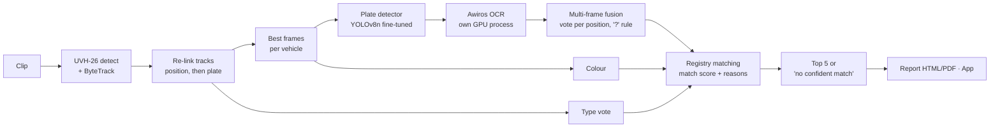

# TRACEVISION AI

**Hack-A-Sol 5.0 · Track 02 · AIML-01: Vehicle Identification and Traceability from CCTV Footage**

Give it a traffic clip. For every vehicle it:
1. **reads the number plate across many frames**, writing **`?`** for characters it can't read and never guessing them
2. estimates **vehicle type** and **colour**
3. **ranks the top 5 registry candidates**, each with a **match score** and **human-readable reasons**, or says **"no confident match"**
4. writes an **investigator report (HTML + PDF)** showing the frames used, the characters read per frame with confidence, the fused plate, and the candidates

> **Status (2026-11-23):** all phases built, tested and evaluated (P1–P6). Remaining owner actions: [NEEDS.md](NEEDS.md).
> Docs: [completions](completions.md) · [whatnext](whatnext.md) · [problems](PROBLEMS.md) · [decisions](DECISIONS.md) · [pipeline design](PIPELINE.md) · [team tasks](TEAM_TASKS.md)

---

## Results on our 11 Indian test clips (51 owner-verified vehicles)
From `python -m tracevision.evaluate` → `TRACEVISION_DATA/reports/p6_evaluation.md`. Labels were written and verified by the team. Each labelled vehicle is linked to the system's vehicle **by box position only**, so the plate scores aren't circular.

| | All | Ground-level / dashcam (9 clips) | CCTV-style, raised (2 clips) |
|---|---|---|---|
| Registered vehicles matched to the right record | **8/9** | 8/9 | — (none registered) |
| Unregistered vehicles given a false confident match | **0/42** | 0/28 | 0/14 |
| **Wrong plate characters output** | **0/132** | 0/132 | — (plates too small) |
| Plate characters read correctly / left as `?` | 85% / 15% | 85% / 15% | — |
| Exact plate (fully readable labels) | 7/10 | 7/10 | — |
| Vehicles detected and tracked | 44/51 | 30/37 | 14/14 |
| Type exact / compatible (car≈SUV) | 68% / 93% | 60% / 93% | 86% / 93% |
| Colour exact / near (white≈silver≈grey) | 25% / 55% | | |
| Processing time | **4–19 s per clip** on an RTX 3050 laptop GPU (clips are 4–30 s long) | | |

**Robustness** (same clips blurred, downscaled to 480p/360p, JPEG q10, night, noise; `python -m tracevision.robustness`):
**0 false identifications under every degradation**, but identification drops to 1/8 registered vehicles under strong blur, downscaling, compression or night, and **some wrong plate characters appear (up to 17% at 360p)**. Details: `TRACEVISION_DATA/reports/p6_evaluation.md`.

**How to read these numbers:**
- The system **prefers `?` to a wrong character**, and **no vehicle outside the registry was ever "identified"**. Those are the properties an investigator needs most.
- On the CCTV-style clips **every plate is under 16 px**, so the system correctly answers "no confident match". It identifies type and colour, not the plate.
- **Colour** is the weakest part: a simple heuristic that struggles with white versus grey versus silver in haze.
- The test set is small (51 vehicles, 9 registered) and mostly ground-level footage (see the limitations below).
- On heavily degraded footage the "never a wrong character" property weakens (see Robustness above).

## How it works

**The two judged algorithms (our own)** are in `tracevision/`:
- **`fuse.py`, multi-frame plate fusion:**
  - aligns every frame's OCR read, so a dropped character doesn't shift the rest
  - folds look-alikes by Indian plate format (letter positions vs digit positions)
  - quality × OCR-probability vote per position
  - emits a character only if it wins ≥ 60% of the vote **and** ≥ 0.8 confidence, otherwise `?`
- **`match.py`, registry ranking:**
  - wildcard- and look-alike-aware plate similarity (0/O/D, 8/B, 1/I, 5/S, 2/Z, 6/G)
  - **match score = 100 × (0.70·plate + 0.15·colour + 0.15·type)**; unknown attributes are dropped from the weighting, not penalised
  - plain-English reasons for every candidate
  - decision: **match**, **ambiguous** (top two too close) or **no confident match** (score under 67.5, or fewer than 5 readable characters)
  - thresholds calibrated on held-out synthetic cases
- 26 unit tests: `python -m pytest tests`

Match score is a **heuristic ranking score, not a probability**. The **registry is synthetic**: fictional records, plus the team's own test vehicles as `evaluation_seed` rows, and **no owner data at all**.

## Run it
**Setup (Windows, NVIDIA GPU):**
```powershell
git config --global core.longpaths true
git lfs install
git clone --recurse-submodules https://github.com/JustinSantosh/trace_vision_nebula.git
cd trace_vision_nebula
python -m pip install torch==2.14.1+cu126 torchvision --index-url https://download.pytorch.org/whl/cu126
python -m pip install paddlepaddle-gpu==3.3.1 -i https://www.paddlepaddle.org.cn/packages/stable/cu126/
python -m pip install ultralytics lap fastapi uvicorn python-multipart jinja2 reportlab pyyaml pandas rapidfuzz safetensors tqdm lmdb shapely pyclipper scikit-image pyarrow
```
**UVH-26 weights:** download `weights/YOLOv11-S/UVH-26-MV-YOLOv11-S.pt` from [huggingface.co/iisc-aim/UVH-26](https://huggingface.co/iisc-aim/UVH-26) into `TRACEVISION_DATA/models/weights/`. The plate detector and Awiros weights come with the repo (Git LFS).

**Use it:**
```powershell
python -m tracevision.api                    # app: open http://127.0.0.1:8000, upload a clip, get the report
python -m tracevision.pipeline --report      # batch: every clip in TRACEVISION_DATA/raw/test_videos -> runs/<clip>/
python -m tracevision.evaluate               # metrics against evaluation/test_clip_labels.csv
python -m tracevision.robustness             # same metrics on blurred / 360p / night / noisy variants
python -m pytest tests                       # unit tests
```
Reports for all test clips: `TRACEVISION_DATA/evaluation/reports/clipNN_report.pdf`.

> **Windows notes:** torch and Paddle can't share one process (conflicting cuDNN), so OCR runs in its own worker process automatically. Anything that trains or validates with ultralytics must run from a `.py` file, not from stdin.

## Data and models
| What | Source | Licence |
|---|---|---|
| Vehicle detector + type | **UVH-26 YOLOv11-S** (IISc), 14 Indian vehicle classes → our types via `models/class_mapping.json` | Apache-2.0 card; **AGPL-3.0** Ultralytics runtime |
| Plate detector | **YOLOv8n fine-tuned by us** on Roboflow **Quobotic** "Indian number plate" v3 (2,069 train images). Leakage-free test mAP50 **0.995**. | Data **CC BY 4.0**, credit: [Quobotic on Roboflow Universe](https://universe.roboflow.com/quobotic/indian-number-plate/dataset/3); model AGPL-3.0 (Ultralytics) |
| Plate OCR | **Awiros ANPR OCR** (PP-OCRv5) with our fixed preprocessing (the official one drops characters). 81.5% exact on 965 plates; 15 ms per crop on GPU. | Apache-2.0 |
| OCR benchmark | zenitsu09 Indian plates (965 unique) | No licence stated; internal evaluation only |
| Test clips | 9 filmed by the team + 2 from Pexels (links in `evaluation/clips.csv`, not re-hosted) | Own / Pexels License |

## Limitations (honest)
- **Footage:** 9 of the 11 clips are ground-level or dashcam and only 2 are CCTV-style. The problem statement is CCTV, so results are always reported separately (DECISIONS E10, PROBLEMS E7). On real CCTV, plates are often too small to read. The system then says so, rather than guessing.
- **Small test set:** 51 vehicles and 9 registered. Several pipeline rules were diagnosed on these clips, so the numbers may be optimistic.
- **Colour** is a heuristic (25% exact). **Car versus SUV** is often confused (types are compatible 93% of the time).
- **Cross-camera re-identification** (bonus) isn't evaluated yet: the two-position car pair hasn't been filmed (see NEEDS.md).
- Most clips are WhatsApp copies (about 1.5 Mbit/s), which costs plate detail.
- On strongly degraded footage (360p, heavy blur, night) the OCR can be confidently wrong (up to 17% wrong characters at 360p). A stricter confidence bar for low-quality plates is the next fix.
