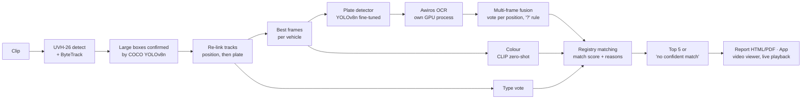

# TRACEVISION AI

**Hack-A-Sol 5.0 · Track 02 · AIML-01: Vehicle Identification and Traceability from CCTV Footage**

Give it a traffic clip. For every vehicle it:
1. **reads the number plate across many frames**, writing **`?`** for characters it can't read and never guessing them
2. estimates **vehicle type** and **colour**
3. **ranks the top 5 registry candidates**, each with a **match score** and **human-readable reasons**, or says **"no confident match"**
4. writes an **investigator report (HTML + PDF)** showing the frames used, the characters read per frame with confidence, the fused plate, and the candidates

> **Status (2026-11-23):** built, tested and evaluated on 19 clips / 67 verified vehicles: **14/15 registered vehicles matched, 0/46 false identifications, 0 wrong plate characters**; cross-camera bonus: 5/5 checkable groups linked, 0 wrong. Remaining owner actions (repo visibility, demo video, slides): [NEEDS.md](NEEDS.md).
> Docs: [completions](completions.md) · [whatnext](whatnext.md) · [problems](PROBLEMS.md) · [decisions](DECISIONS.md) · [pipeline design](PIPELINE.md) · [team tasks](TEAM_TASKS.md)

---

## Results on our 19 Indian test clips (67 owner-verified vehicles)
From `python -m tracevision.evaluate` → `TRACEVISION_DATA/reports/p6_evaluation.md`. Labels were written and verified by the team (clip12–19: AI draft, owner-verified). Each labelled vehicle is linked to the system's vehicle **by box position only**, so the plate scores aren't circular.

| | All | Ground-level / handheld (17 clips) | CCTV-style, raised (2 clips) |
|---|---|---|---|
| Registered vehicles matched to the right record | **14/15** | 14/15 | — (none registered) |
| Unregistered vehicles given a false confident match | **0/46** | 0/32 | 0/14 |
| Vehicles marked "in registry" but whose full plate nobody knows (so not in the registry): false matches | **0/6** | 0/6 | — |
| **Wrong plate characters output** | **0/252** | 0/252 | — (plates too small) |
| Plate characters read correctly / left as `?` | 84% / 16% | 84% / 16% | — |
| Exact plate (fully readable labels) | 14/19 | 14/19 | — |
| Vehicles detected and tracked (at the labelled frame) | 61/67 | 47/53 | 14/14 |
| Type exact / compatible (car≈SUV) | 77% / 95% | | 86% / 93% |
| Colour exact / near (white≈silver≈grey), CLIP zero-shot | 59% / 67% | | |
| Processing time | **5–24 s per clip** on an RTX 3050 laptop GPU (two detectors; clips 3–30 s long); 52 s for the 4K clip10 | | |

*Detection uses two models (M15): UVH-26 (Indian classes, trained on elevated CCTV) plus COCO YOLOv8n, which sees close-up, ground-level vehicles UVH-26 misses or mistypes. Before that change: 52/67 found, 11/15 matched, type 90% compatible. Labels are linked to system vehicles one-to-one by box position (E14). The 1 registered miss: clip15 white SUV (plate unreadable from that spot).*

*On the first 11 clips (before clip12–19 were added): 8/9 matched, 0/42 false, 0/132 wrong characters.*

**Robustness** (same clips blurred, downscaled to 480p/360p, JPEG q10, night, noise; `python -m tracevision.robustness`):
**0 false identifications under every degradation**, but identification drops to 1/8 registered vehicles under strong blur, downscaling, compression or night, and **some wrong plate characters appear (up to 17% at 360p)**. Details: `TRACEVISION_DATA/reports/p6_evaluation.md`.

**How to read these numbers:**
- The system **prefers `?` to a wrong character**, and **no vehicle outside the registry was ever "identified"**. Those are the properties an investigator needs most.
- On the CCTV-style clips **every plate is under 16 px**, so the system correctly answers "no confident match". It identifies type and colour, not the plate.
- **Colour** uses CLIP zero-shot: 64% exact, 75% near. It's still the least reliable attribute (dark or warm-lit vehicles).
- The test set is small (51 vehicles, 9 registered) and mostly ground-level footage (see the limitations below).
- On heavily degraded footage the "never a wrong character" property weakens (see Robustness above).

## How it works

**The two judged algorithms (our own)** are in `tracevision/`:
- **`fuse.py`, multi-frame plate fusion:**
  - aligns every frame's OCR read, so a dropped character doesn't shift the rest
  - folds look-alikes by Indian plate format (letter positions vs digit positions)
  - quality × OCR-probability vote per position
  - emits a character only if it wins ≥ 60% of the vote **and** ≥ 0.8 confidence, otherwise `?`
- **`match.py`, registry ranking:**
  - wildcard- and look-alike-aware plate similarity (0/O/D, 8/B, 1/I, 5/S, 2/Z, 6/G)
  - **match score = 100 × (0.70·plate + 0.15·colour + 0.15·type)**; unknown attributes are dropped from the weighting, not penalised
  - plain-English reasons for every candidate
  - decision: **match**, **ambiguous** (top two too close) or **no confident match** (score under 67.5, or fewer than 5 readable characters)
  - thresholds calibrated on held-out synthetic cases
- 26 unit tests: `python -m pytest tests`

Match score is a **heuristic ranking score, not a probability**. The **registry is synthetic**: fictional records, plus the team's own test vehicles as `evaluation_seed` rows, and **no owner data at all** (the enforcement demo's owner and challan records are separate synthetic files, see below).

## Run it
**Setup (Windows, NVIDIA GPU):**
```powershell
git config --global core.longpaths true
git lfs install
git clone --recurse-submodules https://github.com/JustinSantosh/trace_vision_nebula.git
cd trace_vision_nebula
python -m pip install torch==2.14.1+cu126 torchvision --index-url https://download.pytorch.org/whl/cu126
python -m pip install paddlepaddle-gpu==3.3.1 -i https://www.paddlepaddle.org.cn/packages/stable/cu126/
python -m pip install ultralytics lap fastapi uvicorn python-multipart jinja2 reportlab pyyaml pandas rapidfuzz safetensors tqdm lmdb shapely pyclipper scikit-image pyarrow open_clip_torch   # CLIP ViT-B/32 weights (~580 MB) download on first run
```
**UVH-26 weights:** download `weights/YOLOv11-S/UVH-26-MV-YOLOv11-S.pt` from [huggingface.co/iisc-aim/UVH-26](https://huggingface.co/iisc-aim/UVH-26) into `TRACEVISION_DATA/models/weights/`. The plate detector and Awiros weights come with the repo (Git LFS).

**Use it:**
```powershell
python -m tracevision.api                    # app: open http://127.0.0.1:8000, upload a clip, get the report
#   -> after analysis click "▶ Open video viewer": the clip plays with tracked boxes, and a side panel shows each vehicle's
#      picked plate frames, per-frame reads, fused plate and top-5 candidates. Stored clips: http://127.0.0.1:8000/viewer/runs/clip03
#      "live playback" (on by default) reveals the finished analysis in step with the video: box -> each plate read at its
#      frame -> "checking registry" -> MATCH / no confident match, narrated in a live feed. Nothing is recomputed in the browser.
python -m tracevision.pipeline --report      # batch: every clip in TRACEVISION_DATA/raw/test_videos -> runs/<clip>/
python -m tracevision.evaluate               # metrics against evaluation/test_clip_labels.csv
python -m tracevision.robustness             # same metrics on blurred / 360p / night / noisy variants
python -m tracevision.crosscam --pairs        # cross-camera links for the parking pairs (clip12-19)
python -m pytest tests                       # unit tests
```
Reports for all test clips: `TRACEVISION_DATA/evaluation/reports/clipNN_report.pdf`.

> **Windows notes:** torch and Paddle can't share one process (conflicting cuDNN), so OCR runs in its own worker process automatically. Anything that trains or validates with ultralytics must run from a `.py` file, not from stdin.

## Cross-camera re-identification (bonus)
`python -m tracevision.crosscam clip12 clip13` (or `--pairs` for every camera pair in `clips.csv`) links each vehicle in one clip to the same vehicle in another, or says **no link**. Evidence: **plate** (symmetric wildcard / look-alike similarity on ≥ 5 characters both clips read; clearly different plates **veto** a link), **CLIP appearance** (calibrated on clips 01–11 only), type and colour. A link must be a **mutual best match** with a clear margin; plate-agreeing candidates rank above appearance-only ones; appearance-only links need a CLIP cosine above 99% of different-vehicle pairs. Output: `runs/crosscam/<a>__<b>.json` with a link score (not a probability) and reasons.

**Declared same-scene (cross-angled) camera pairs (M16).** *Only for cameras that watch the **same spot from different angles** (overlapping views), so both see the same vehicles at the same time — e.g. two cameras on one junction or one parking area. Cameras at different places are **not** paired this way: any vehicle may appear in only one of them, so they use the open-world, plate-only linking above.* The owner filmed each pair so that both clips show the **same vehicles from two angles** (`clips.csv` camera ids `cam_parking_pairN_a/b`). For such pairs `--pairs` also solves the whole pair jointly: (1) **plate-confirmed** links first (plate similarity ≥ 0.9 on ≥ 5 jointly read characters), (2) nested duplicate boxes folded into one vehicle, (3) the rest paired one-to-one (Hungarian) on type / colour / appearance, (4) a last compatible vehicle on each side linked **by elimination** if their partial plates agree. Each linked vehicle then gets **one final answer**: its plate is re-fused from **both cameras' reads**, type and colour pooled, one registry check. A confident identity comes **only** from plate-confirmed links; probable links report a *candidate*.

| Group | Link | Final answer (both angles pooled) |
|---|---|---|
| X1 sedan (clip12↔13) | confirmed by plate | `CG04NL3024` → **match** |
| X2 dark SUV (clip14↔15) | confirmed by plate | `CG04QS9584` → no match (not in the registry) |
| X3 white SUV (clip14↔15) | probable (elimination; partial plates agree) | `CG14MW3529` → **candidate** `CG14MW3529` |
| X4 motorcycle (clip16↔17) | confirmed by plate | `CG04DK1578` → **match** |
| X5 Activa, plate hidden (clip16↔17) | probable (appearance / elimination) | plate unknown |
| X6, X7 | not checkable (tracked only after the labelled frame) | — |

**In the app:** the video viewer shows a ⇄ badge on linked vehicles and a "Same vehicle in another camera" panel (link type, pooled final answer, reasons) with a link that opens the other clip at that vehicle (`/viewer/runs/clip15?track=1`).

**Score** (`python -m tracevision.crosscam --evaluate`, labels tied to tracks one-to-one by box position): **5 of 5 checkable groups correct, 0 wrong links.** Without the pair declaration (open world, `python -m tracevision.crosscam clipA clipB`) only plate evidence links, and appearance alone is unreliable across viewpoints (C12).

## Enforcement add-on (synthetic demo data)
Open the **Enforcement** tab, or the **Vehicle record** and **Direction** findings in a case. Pick a role at the top right.
- **Vehicle record:** for a vehicle with a **confident** registry match only, a synthetic record: make, model, class, fuel, RTO, registration / insurance / PUC validity, registered owner, and e-challan history with pending amount. Analysts see the owner masked and challan totals only. Investigators and officers see everything after giving a reason. **Every lookup is logged** (officers can read the log). Data: `python TRACEVISION_DATA/scripts/generate_vehicle_intel.py` (seeded; 334 owner records, 403 challans). **Not** a VAHAN / e-Challan lookup, and the role picker is not a login (DECISIONS E17).
- **Wrong-side driving:** fixed cameras only (clip02, clip06). Hand-drawn zones with a permitted direction (`TRACEVISION_DATA/cameras/camera_rules.json`); camera pan is removed first. A flagged vehicle waits for an officer to confirm or reject; a confirmed flag on a matched vehicle raises a **simulated** challan that is never sent anywhere. Result on our footage: **54 vehicles checked, 0 flagged** (no wrong-side event was filmed); the rule flags clip02's real tracks when they are replayed backwards (unit test). `python -m tracevision.violations` prints the per-clip check (DECISIONS E18).

## Data and models
| What | Source | Licence |
|---|---|---|
| Vehicle detector + type | **UVH-26 YOLOv11-S** (IISc), 14 Indian vehicle classes → our types via `models/class_mapping.json` | Apache-2.0 card; **AGPL-3.0** Ultralytics runtime |
| Plate detector | **YOLOv8n fine-tuned by us** on Roboflow **Quobotic** "Indian number plate" v3 (2,069 train images). Leakage-free test mAP50 **0.995**. | Data **CC BY 4.0**, credit: [Quobotic on Roboflow Universe](https://universe.roboflow.com/quobotic/indian-number-plate/dataset/3); model AGPL-3.0 (Ultralytics) |
| Plate OCR | **Awiros ANPR OCR** (PP-OCRv5) with our fixed preprocessing (the official one drops characters). 81.5% exact on 965 plates; 15 ms per crop on GPU. | Apache-2.0 |
| OCR benchmark | zenitsu09 Indian plates (965 unique) | No licence stated; internal evaluation only |
| Test clips | 9 filmed by the team + 2 from Pexels (links in `evaluation/clips.csv`, not re-hosted) | Own / Pexels License |

## Limitations (honest)
- **Footage:** 9 of the 11 clips are ground-level or dashcam and only 2 are CCTV-style. The problem statement is CCTV, so results are always reported separately (DECISIONS E10, PROBLEMS E7). On real CCTV, plates are often too small to read. The system then says so, rather than guessing.
- **Small test set:** 51 vehicles and 9 registered. Several pipeline rules were diagnosed on these clips, so the numbers may be optimistic.
- **Colour** uses CLIP zero-shot (64% exact, 75% near). It answers `unknown` at night and still slips on dark or warm-lit vehicles. **Car versus SUV** is often confused (types are compatible 93% of the time).
- **Cross-camera re-identification** (bonus, `python -m tracevision.crosscam --pairs`) links vehicles **by plate**; generic CLIP appearance across viewpoints is unreliable (the same parking lot's background dominates), so appearance-only links need a very high similarity and were never made on our pairs. On the declared parking pairs: 5 of 5 checkable groups linked correctly, 0 wrong (see the cross-camera section).
- **Enforcement add-on:** all owner and challan data is synthetic, and roles are not authenticated. Wrong-side driving was never observed in our clips, so it is validated only by replaying real tracks backwards. Moving-camera clips aren't assessed.
- Most clips are WhatsApp copies (about 1.5 Mbit/s), which costs plate detail.
- On strongly degraded footage (360p, heavy blur, night) the OCR can be confidently wrong (up to 17% wrong characters at 360p). A stricter confidence bar for low-quality plates is the next fix.
