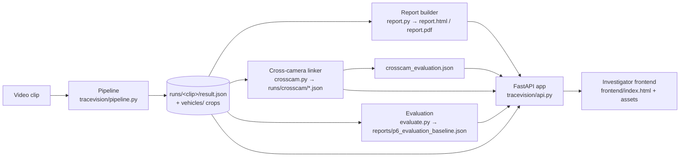
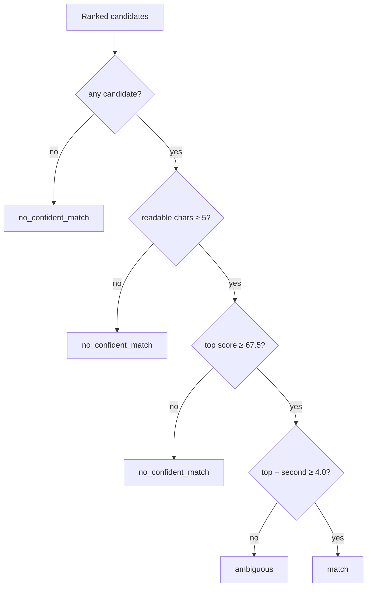
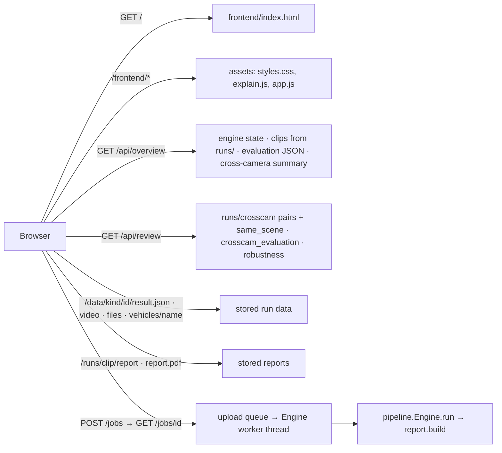

# TRACEVISION AI — Technical Architecture

Source of truth: the code in `tracevision/` and `frontend/`, and the thresholds in `tracevision/config.yaml`. This document describes only what is implemented. Planned or unverified items are marked as such. Design rationale lives in `PIPELINE.md` and `DECISIONS.md` (IDs such as M8 and E14 refer to that file).

## 1. System overview



Every stage writes plain files. The app only reads them, plus the upload queue when the engine is running. This is why the UI can run in **UI-only mode** on a machine without the model stack.

## 2. Vision pipeline (`tracevision/pipeline.py`)

```mermaid
flowchart TD
  A[Frames, every 2nd<br/>detect_every: 2] --> B[UVH-26 YOLOv11-S<br/>14 Indian classes, conf 0.25, 640 px]
  B --> C[ByteTrack<br/>ultralytics tracker]
  A --> D[COCO YOLOv8n tracking pass<br/>ensemble, M15]
  C & D --> E[Merge: COCO adds type votes / missed frames;<br/>overrides type only when UVH-26 conf &lt; 0.5]
  E --> F[Large-track check, C11:<br/>tracks ≥ 10% of the frame must be confirmed by COCO]
  F --> G[Filters: ≥ 5 detections, reaches ≥ 0.4% of frame area]
  G --> H[Re-link: by position (gap ≤ 30 frames, ≤ 1 box diagonal),<br/>then by plate (≥ 6 agreeing characters)]
  H --> I[Best frames per track<br/>8 candidates, ≥ 4 frames apart]
  I --> J[Plate detector: YOLOv8n fine-tuned on Quobotic<br/>on the upscaled vehicle crop, conf 0.5]
  J -->|plate &lt; 16 px tall| K[Reported unreadable<br/>never OCR'd, M8]
  J -->|top 5 crops| L[Awiros PP-OCRv5 OCR<br/>separate process: ocr_worker.py]
  L --> M[Multi-frame fusion<br/>fuse.py]
  I --> N[Colour: CLIP ViT-B/32 zero-shot<br/>colour.py, 3 frames]
  H --> O[Type: vote over the track]
  M & N & O --> Q[Registry ranking + decision<br/>match.py]
  Q --> S[(result.json)]
```

| Stage | Implementation | Key settings (`config.yaml`) |
|---|---|---|
| Vehicle detection and type | UVH-26 YOLOv11-S (IISc). Classes are mapped to our types by `TRACEVISION_DATA/models/class_mapping.json` | `vehicle_conf 0.25`, `imgsz 640`, `detect_every 2` |
| Second detector | COCO YOLOv8n tracking pass (`ensemble_coco`). It adds missed frames and type votes, and adds confident COCO-only tracks | override below UVH-26 conf 0.5 |
| Phantom-box removal | `verify_large_tracks`: a large track must overlap a COCO vehicle box | `verify_large_frac 0.10`, `verify_min_iou 0.3`, `verify_min_share 0.34` |
| Tracking | ByteTrack (ultralytics `track`), then `relink` | `min_track_dets 5`, `relink_gap_frames 30`, `plate_link_min_known 6` |
| Plate detection | YOLOv8n fine-tuned by the team (leakage-free test mAP50 0.995, `reports/p2_plate_detector.md`) | `conf 0.5`, `min_plate_height_px 16` |
| OCR | Awiros ANPR OCR (PP-OCRv5) in its own spawned process (torch and Paddle conflict over cuDNN on Windows). It returns per-character probabilities and top-3 alternatives | `ocr_top_k 5` |
| Colour | CLIP zero-shot over 10 colour names; "too dark → unknown". Falls back to a hue heuristic if `open_clip` is missing | `colour.method clip` |

**Hardware note:** `run_clip` calls YOLO with `device=0` and starts OCR with `device="gpu"`, so the pipeline needs a CUDA GPU. Stored results were produced on an RTX 3050 laptop.

## 3. Multi-frame plate fusion (`tracevision/fuse.py`, our own algorithm)
1. **Align** every frame's read to a reference (edit-distance alignment), so a dropped character doesn't shift the rest.
2. **Fold look-alikes by Indian plate format** (`plates.py`): letter positions and digit positions; a cross-class vote counts half (`cross_class_weight 0.5`).
3. **Vote per position**, weighted by frame quality × OCR probability. Top-3 alternatives also vote (`use_top3`).
4. **Emit a character only if** it wins ≥ 60% of the vote (`tau_share 0.6`) **and** its quality-weighted mean probability is ≥ 0.8 (`tau_prob 0.8`). **Otherwise the position is `?`.** A character no frame read can never be emitted (`tests/test_fuse.py::test_never_emits_a_character_nobody_read`).

The output (`plate.positions[]`) keeps, for each position, the character, its confidence, its vote share, its support and the frames it came from. These are shown in the UI and reports.

## 4. Registry ranking and abstention (`tracevision/match.py`, our own algorithm)
- **Plate similarity:** wildcard-aware (`?` costs nothing) and look-alike-aware (0/O/D/Q, 1/I, 2/Z, 5/S, 8/B, 6/G cost 0.4).
- **Match score** = 100 × (0.70·plate + 0.15·colour + 0.15·type). Unknown colour or type is dropped from the weighting, not penalised. **It is a ranking score, not a probability.**
- **Candidates:** top 5; candidates under plate similarity 0.5 are dropped unless the plate is mostly unknown.
- **Decision rule** (`decide`), applied in this order:


The thresholds 67.5 and 4.0 were calibrated on held-out synthetic cases (`calibrate.py`). Every `result.json` stores the thresholds it was produced with under `config.match`. The frontend's "Why this decision" panel lays those stored thresholds next to the stored scores (`frontend/assets/explain.js`). A test checks that this reading reproduces the stored decision for every vehicle in all 19 results (`frontend/tests/explain.test.js`).

**Three separate signals, never combined:**

| Signal | Field in result.json | Meaning |
|---|---|---|
| Detector confidence | `vehicles[].type.detector_conf_mean` | Mean vehicle-detector confidence over the track |
| OCR confidence | `plate.per_frame_reads[].char_probs`, `plate.positions[].confidence` | Per-character recognition confidence, per frame and fused |
| Registry match score | `candidates[].match_score` (+ `plate_score`, `colour_score`, `type_score`) | 0–100 ranking score against registry records |

## 5. Cross-camera linking (`tracevision/crosscam.py`, bonus)
Two modes, both reading two `result.json` files:

| Mode | Function | When | How |
|---|---|---|---|
| Directional, open world | `link()` | Any two clips | For each vehicle in A: plate similarity (a clear mismatch **vetoes** the link), CLIP appearance similarity (calibrated on clips 01–11), type and colour. Link only if the score ≥ `t_link` 70, margin ≥ 8, and the pair is a **mutual** best match. Written as `runs/crosscam/<a>__<b>.json` → `links`. |
| Same-scene pair, closed world (M16) | `link_pair()` | Only for **owner-declared** pairs of cross-angled cameras on the same spot (`clips.csv` `cam_parking_pairN_a/b`) | 1) plate-confirmed links, one-to-one; 2) the remaining tracks by Hungarian assignment, accepted only as **probable** (appearance/elimination); 3) per link, pooled evidence across both cameras: one fused plate, type, colour and registry decision. **Only plate-confirmed links can give a registry match.** A probable link yields `candidate_via_probable_link`, never `match`. Stored under `pair_linking` in the forward pair file. |

`--evaluate` scores the pair links against `cross_camera_ground_truth.csv`, associating labels by box position only (never by plate) → `TRACEVISION_DATA/reports/crosscam_evaluation.json`. Current file: 7 groups, 5 correct links, 0 wrong, 2 not tracked at the labelled frame.

**Scope:** this is not city-wide re-identification. The closed-world mode is valid only for cameras watching the same spot.

## 6. Application (`tracevision/api.py`)


- **Engine:** loaded once, in a background thread at startup (`_worker`). Start-up failures are recorded and shown to the user; jobs queued before a failure are marked as errors; `POST /jobs` returns 503 after a known failure.
- **UI-only mode:** `TRACEVISION_UI_ONLY=1` skips the engine thread completely (no model import). `/api/overview` then reports `engine.status = "disabled"`, and `POST /jobs` returns 503 with an explanation. All stored-result routes are unchanged.
- **Safety:** binds to 127.0.0.1; upload extension and size are checked (500 MB); `/viewer`, `/data`, `/runs` path parameters are matched against `clip\d+` / 12-hex job IDs / a strict crop-name pattern (traversal probes return 404, `tests/test_api_ui.py`).
- **Evaluation headline:** read from `p6_evaluation_baseline.json` (machine-written by `evaluate.py`); the Markdown report is only a fallback.

## 7. Investigator frontend (`frontend/`)
No build step, no npm, no CDN. Hash-routed single page:

| Route | View | Data |
|---|---|---|
| `#top` (default) | Overview: case-file totals, evaluation snapshot, upload, stored clips | `/api/overview` |
| `#results/runs/clipNN`, `#results/jobs/<id>` | Annotated video (canvas boxes per recorded frame), evidence index, vehicle detail: attributes, the three separate scores, fused plate cells, per-frame OCR reads with timestamps, **decision rule panel**, top-5 candidates with component scores, lead over next, position-by-position plate comparison and recorded reasons | `/data/...` |
| `#crosscam` | Two synchronised videos with boxes; evaluation reference labels; **same-scene joint links** (confirmed vs probable, pooled identity); directional per-direction evidence | `/api/review`, `/data/...` |
| `#reports` | Stored HTML report preview plus downloads | `/runs/...` |
| `#insights` | Evaluation metrics, robustness variants (with their date caveat), cross-camera outcomes | `/api/overview`, `/api/review` |
| `#demo/...` | Rehearsal mode: **explicitly simulated** stage progress, then opens the stored result with a banner | stored data only |

`frontend/assets/explain.js` holds the explainability logic as pure functions (no DOM), tested with `node --test frontend/tests/explain.test.js`.

## 8. Reports (`tracevision/report.py`)
`build(run_dir)` writes `report.html` (self-contained: crops embedded as data URIs) and `report.pdf` (ReportLab) from `result.json` and the `vehicles/` crops. They contain the clip metadata, decisions summary, and for each vehicle: track span, type (vote share), colour (confidence), per-frame plate crops with per-character OCR confidence, the fused plate with confidence and vote share, the top-5 candidates with match score and reasons, and the decision reason. Reports are rebuilt only when the pipeline runs (batch `--report` or after an upload job). Rebuilding without `vehicles/` produces reports without images.

## 9. Evaluation (`tracevision/evaluate.py`)
Scores `runs/*/result.json` against owner-verified labels (`TRACEVISION_DATA/evaluation/test_clip_labels.csv`, 67 vehicles in 19 clips). Labels are linked to system vehicles **one-to-one by box overlap** (IoU ≥ 0.3, ±4 frames; E14), never by plate text, so the plate metrics aren't circular. Current output (`p6_evaluation_baseline.json`; it reproduces from the stored results): 14/15 registered matched, 0/46 false confident matches, 0/252 wrong plate characters, 211/252 correct, 61/67 detected and tracked, type 77% exact / 95% compatible.

## 10. Known limitations
- Small test set (67 vehicles, 15 registered); several rules were tuned on these clips.
- Only 2 clips are raised CCTV-style. Their plates are below 16 px, so they always get "no confident match".
- The robustness sweep (`p6_robustness.json`) predates the ensemble, phantom-box and CLIP-colour changes and wasn't re-run.
- The pipeline needs CUDA. Plate/vehicle crops (`runs/**/vehicles/`) and two Pexels videos (clip10, clip11) are not in git.
- Colour is the weakest attribute (59% exact).
