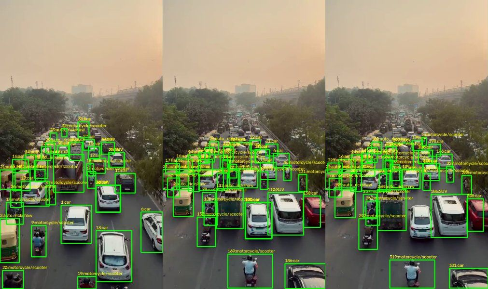
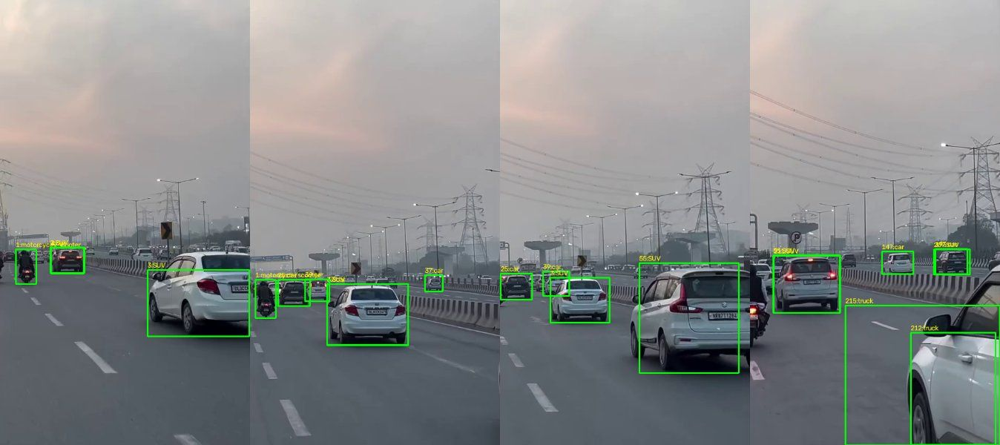

# P1: Vision stack setup and smoke test

**Date:** 2026-11-23 · **Approved by the owner:** "Approve P1" · Scripts: `scripts/smoke/p1_detect_track_smoke.py`, `scripts/smoke/p1_two_process_gpu_test.py`

## Installed (approved)
| Package | Version | Notes |
|---|---|---|
| torch / torchvision | **2.14.1+cu126** | CUDA works on the RTX 3050 6 GB Laptop GPU, with cuDNN 9.10 |
| ultralytics | 8.4.216 | YOLO and ByteTrack. Licence AGPL-3.0 (B6). |
| lap | 0.5.14 | Needed by ByteTrack |
| *(already present)* paddlepaddle-gpu | 3.3.1 (cu126) | Awiros OCR. Still works on its own after the torch install. |

**Weights:** `models/weights/UVH-26-MV-YOLOv11-S.pt`, 57,142,241 bytes, sha256 `12dbeb8f6fa207d1…`. It matches the Hugging Face LFS checksum. It's git-ignored; teammates download it from `huggingface.co/iisc-aim/UVH-26`.

## Finding 1: torch and Paddle can't share one process on Windows
Each ships its own cuDNN 9 DLLs, and they differ. Importing either one first makes the other fail with `WinError 127 … cudnn_cnn64_9.dll`. **Fix (tested): OCR runs in a separate worker process** (`multiprocessing` spawn with a queue). The main process runs torch/YOLO and the worker runs Paddle/Awiros, both on the same GPU.
- Main process: YOLO works before and after the worker runs.
- Worker: **about 15 ms per plate crop** after warm-up (the first call takes about 0.5 s).
- Recorded as DECISIONS M7 and PIPELINE.md stage 6.

## Finding 2: UVH-26's real class names (resolves B3)
The card lists 13 classes, but the model has **14**: Hatchback, Sedan, SUV, MUV, Bus, Truck, Three-wheeler, Two-wheeler, LCV, Mini-bus, tempo-traveller, bicycle, Van, **Others**. It was trained at **640 px**. The mapping is in `models/class_mapping.json`. Judgement calls (DECISIONS M6):
- MUV → SUV
- Three-wheeler → auto_rickshaw
- Two-wheeler → `motorcycle/scooter`, which is ambiguous; no split is invented
- LCV → truck
- tempo-traveller → van

## Finding 3: Detection and tracking smoke test (every 2nd frame, 640 px, conf 0.25)
| Clip | Frames run | ms per frame | Tracks (≥ 5 detections) | Types of those tracks |
|---|---|---|---|---|
| clip02 (fixed, crowded) | 123 | 48.3* | 96 | car 34, motorcycle/scooter 28, auto_rickshaw 24, SUV 4, truck 4, bus 2 |
| clip01 (moving) | 489 | 13.3 | 52 | car 29, SUV 12, truck 6, motorcycle/scooter 5 |

*clip02 ran first, so its time includes model warm-up.

**What works:** crowded scenes, autos and two-wheelers far back, and close vehicles in moving clips.
**Issues to handle in later stages (not P1 failures):**
1. **Track fragmentation:** one vehicle can get several IDs, especially in moving clips (118 raw tracks in clip01). **Fix:** a re-link step before fusion that joins tracks with the same type, overlapping time and agreeing plate characters.
2. **Edge-cut vehicles get the wrong type:** a half-visible car at the frame edge was labelled `truck`, and a sedan was `SUV` in one frame. **Fix:** leave edge-touching boxes out of the type vote, and use the confidence-weighted vote over the whole track (stage 3).
3. Small far-away vehicles in clip02 are detected, but their plates will be unreadable. That's expected, and the system should report `none` / no confident match.

These are smoke checks, not accuracy numbers. Accuracy comes from the hand labels (P6).
