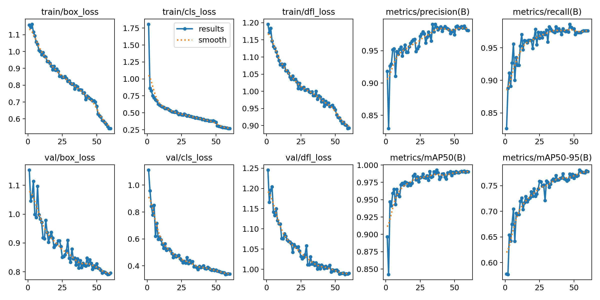
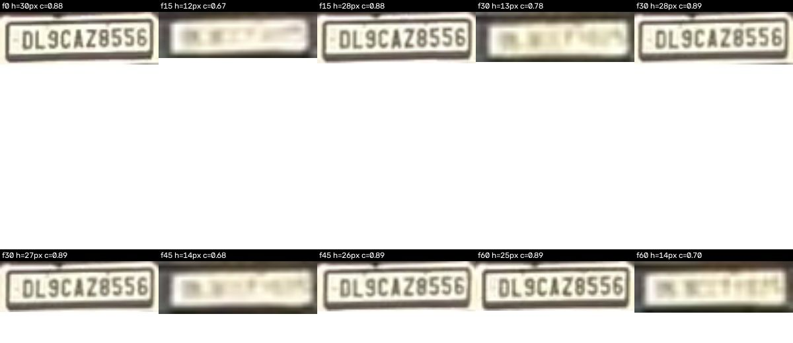
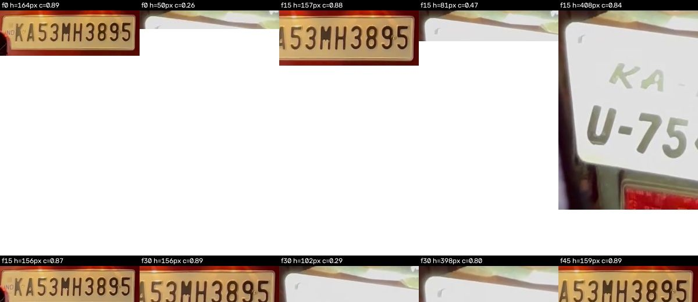
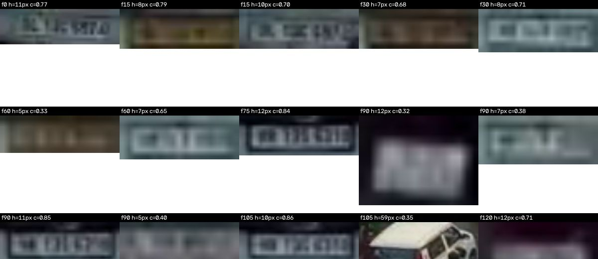

# P2: Plate detector (YOLOv8n fine-tuned on Quobotic)

**Date:** 2026-11-23 · **Approved by the owner:** "Approve P2"
**Weights:** `models/weights/plate_yolov8n_quobotic.pt`, 6.5 MB, sha256 `3f8e000939826df6…`. Shared via Git LFS.
**Scripts:** `scripts/smoke/p2_train_plate_detector.py`, `scripts/smoke/p2_eval_plate_detector.py` · raw numbers in `p2_eval.json` and `p2_training_results.csv`

## Training
- Base: YOLOv8n (COCO), 640 px, batch 16, 60 epochs, seed 0, deterministic, RTX 3050. **24 minutes in total.**
- Data: `processed/plate_detection/data.yaml` (2,069 train / 336 valid). Official splits kept (DECISIONS D7).
- A 1-epoch smoke run on 10% of the data came first. **Windows gotcha:** training must run from a `.py` file. Run from stdin, the data-loader workers hang with the GPU idle.
- Best epoch 54, on validation: **P 0.986, R 0.973, mAP50 0.990, mAP50-95 0.781**.

## Test results
| Test set | Images | Precision | Recall | mAP50 | mAP50-95 |
|---|---|---|---|---|---|
| Official Quobotic test | 169 | 0.994 | 0.987 | **0.995** | 0.788 |
| **Leakage-free test** (A15) | 106 | 0.991 | 0.980 | **0.995** | **0.754** |

**The leakage barely changes detection** (mAP50 is the same). It shows up only in box tightness (mAP50-95 0.788 against 0.754). **Report the leakage-free numbers.** These are still photos with large plates, though: **they do not predict CCTV performance** (A13).

## On our clips (UVH-26 vehicle → plate detector on the upscaled vehicle crop, every 15th frame)
| Clip | Camera | Vehicles checked | Plates found | Median plate height |
|---|---|---|---|---|
| clip01 | moving, WhatsApp copy | 285 | 134 | 13 px |
| clip03 | moving, WhatsApp copy (720p) | 172 | 106 | 20.5 px |
| clip08 | moving, low light | 173 | 51 | 13 px |
| clip10 | moving, **4K** | 35 | 24 | 151 px |
| clip11 | night, **4K** | 27 | 28 | 164.5 px |
| clip02 | **fixed, CCTV-style** | 393 | 25 | **9 px** |

**What this shows:**
1. **Close plates are found and cropped cleanly** in daylight, at night and on two-wheelers.
2. **Far plates are still *found*,** but at 5–14 px tall **no OCR can read them.** That's a limit of the footage, not of the detector. The WhatsApp clips are mostly in this range; clip03 is borderline.
3. **False detections have low confidence** (0.26–0.47): white body panels, a dark blob.

## Settings carried into the pipeline (DECISIONS M8)
- Plate confidence threshold: **0.5**.
- **Minimum plate height for OCR: 16 px.** Below that the plate is reported as *unreadable* (`none`, or `?` positions). It is never read or guessed.
- Run the plate detector on the **vehicle crop upscaled to 640 px**, not on the full frame.
- Results stay split by camera type (E10). On CCTV-style clip02, most plates are under 16 px, so expect "no confident match". That is the correct behaviour, not a failure.
